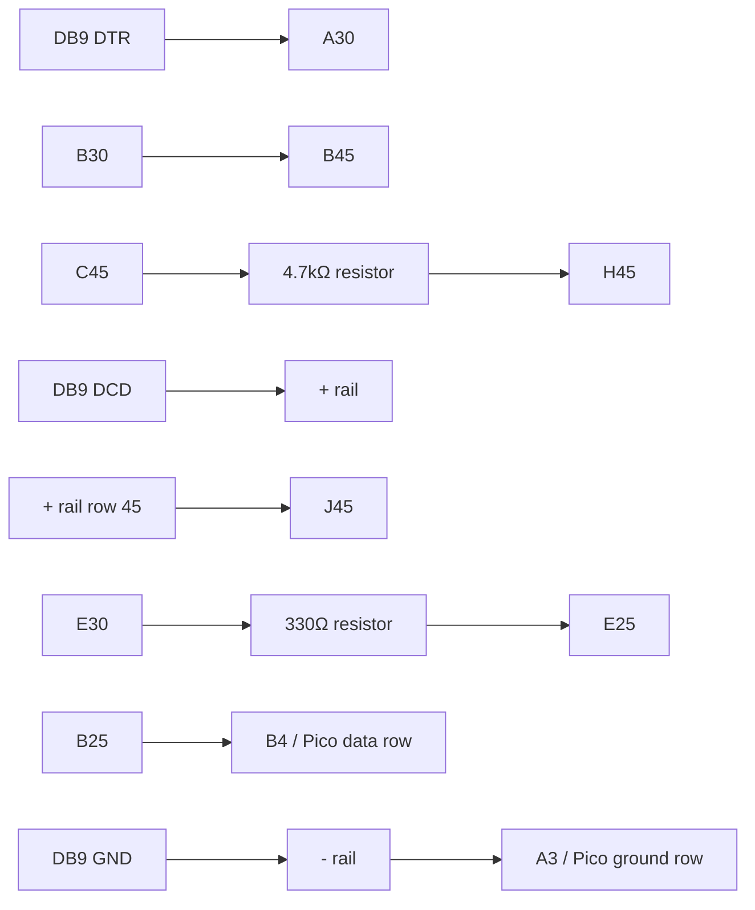

# NICE 64 Breadboard Build Guide

This document describes the breadboard wiring used for the NICE 64 prototype shown in the reference photos.

> **Prototype note:** This is a breadboard build, not a production PCB. Verify all rows, rails, resistor values, and Pico pin placement before powering the device.

---

## 1. Parts Used

These are the Amazon parts used for this prototype build.

| Purpose | Item / Description | Link |
|---|---|---|
| N64/SNES/GameCube HDMI adapter for video capture/testing | LEVELHIKE HDMI Cable for GameCube / N64 / SNES | <https://www.amazon.com/dp/B07Z5TDL2X> |
| HDMI capture device | 4K HDMI Video Capture Card, 1080p 60 FPS capture | <https://www.amazon.com/dp/B097DKNS1M> |
| N64 controller extension cables | Ssgamer 2-pack N64 controller extension cables | <https://www.amazon.com/dp/B07PKRPHPC> |
| DB9 breakout connector option | 2-pack DB9 male breakout terminal adapters | <https://www.amazon.com/dp/B093CV87TC> |
| DB9 breakout connector option | Twinklebay DB9 male/female breakout connector set | <https://www.amazon.com/dp/B073RGGDKH> |
| Resistors | VIBICCK 600-piece resistor kit, includes 330 ohm and 4.7k ohm values | <https://www.amazon.com/dp/B0FRY2V145> |
| Breadboard and jumper wires | BOJACK solderless breadboard and jumper wire kit | <https://www.amazon.com/dp/B08Y59P6D1> |
| Microcontroller | Raspberry Pi Pico 2 W compatible board with pre-soldered color headers | <https://www.amazon.com/dp/B0DP54FWX1> |

Only the Pico, breadboard, jumper wires, DB9 breakout, N64 controller extension cable, and resistors are part of the electrical build. The HDMI adapter and capture card are for video output/capture during testing.

---

## 2. DB9 Breakout Pin Usage

The DB9 breakout used in this build exposes the following labeled pins:

| DB9 Label | Used For | Wire Color in Prototype |
|---|---|---|
| DCD | Positive rail / pull-up side | Red |
| DTR | N64 controller data/input path | White |
| GND | Ground | Black |

Unused DB9 terminals are left disconnected.

---

## 3. Breadboard Coordinate Map

The Pico is installed across the breadboard from:

```text
Pico top: C1 - H1
Pico bottom: C20 - H20
```

This means the Pico straddles the center gap, with one side on columns C/D/E and the other side on F/G/H.

---

## 4. Wiring Table

| Step | Connection | Wire / Component | Notes |
|---:|---|---|---|
| 1 | DB9 DTR -> A30 | White wire | DB9 DTR enters the breadboard at row 30. |
| 2 | B30 -> B45 | White jumper | Carries the DTR/data-side signal down the breadboard. |
| 3 | C45 -> H45 | 4.7k ohm resistor | Pull-up / bias resistor path. |
| 4 | DB9 DCD -> positive rail | Red wire | Connects DB9 DCD to the breadboard + rail. |
| 5 | + rail row 45 -> J45 | Jumper | Connects positive rail to row 45. |
| 6 | E30 -> E25 | 330 ohm resistor | Series resistor in the data path. |
| 7 | B25 -> B4 | White wire | Data line from breadboard row 25 to Pico-side row 4. |
| 8 | DB9 GND -> negative rail | Black wire | Connects DB9 ground to breadboard - rail. |
| 9 | negative rail -> A3 | Black jumper | Brings ground from the rail to the Pico-side ground row. |

---

## 5. Simplified Signal Diagram



---

## 6. Physical Build Order

1. Place the Pico on the breadboard from `C1-H1` through `C20-H20`.
2. Connect DB9 `GND` to the breadboard negative rail using a black wire.
3. Connect the negative rail to `A3` using a black jumper.
4. Connect DB9 `DCD` to the positive rail using a red wire.
5. Add a jumper from the positive rail at row 45 to `J45`.
6. Connect DB9 `DTR` to `A30` using a white wire.
7. Add a white jumper from `B30` to `B45`.
8. Install the 4.7k ohm resistor from `C45` to `H45`.
9. Install the 330 ohm resistor from `E30` to `E25`.
10. Connect the data wire from `B25` to `B4` using a white wire.
11. Before powering the Pico, verify continuity with a multimeter.

---

## 7. Verification Checklist

Before powering the build:

- [ ] Pico is seated correctly from `C1-H1` to `C20-H20`.
- [ ] DB9 `GND` goes to the negative rail.
- [ ] Negative rail is connected to `A3`.
- [ ] DB9 `DCD` goes to the positive rail.
- [ ] Positive rail row 45 is connected to `J45`.
- [ ] DB9 `DTR` goes to `A30`.
- [ ] `B30` is jumpered to `B45`.
- [ ] 4.7k ohm resistor is installed from `C45` to `H45`.
- [ ] 330 ohm resistor is installed from `E30` to `E25`.
- [ ] Data wire goes from `B25` to `B4`.
- [ ] No accidental shorts exist between positive and negative rails.
- [ ] Resistor values were confirmed by color code or multimeter.

---

## 8. Notes for GitHub README

Recommended repository layout:

```text
NICE64/
├─ README.md
├─ firmware/
├─ pc-app/
├─ docs/
│  ├─ NICE64_Breadboard_Build.md
│  └─ photos/
└─ hardware/
   └─ bill-of-materials.md
```

Recommended photo names:

```text
docs/photos/nice64-db9-breakout.jpg
docs/photos/nice64-breadboard-overview.jpg
docs/photos/nice64-pico-side.jpg
docs/photos/nice64-resistor-layout.jpg
```

---

## 9. Safety / Build Disclaimer

This wiring is documented from the working prototype. Breadboard rows, Pico orientation, and DB9 breakout labels may differ if different parts are used. Always verify with a multimeter before connecting to the N64, Pico, or PC.
